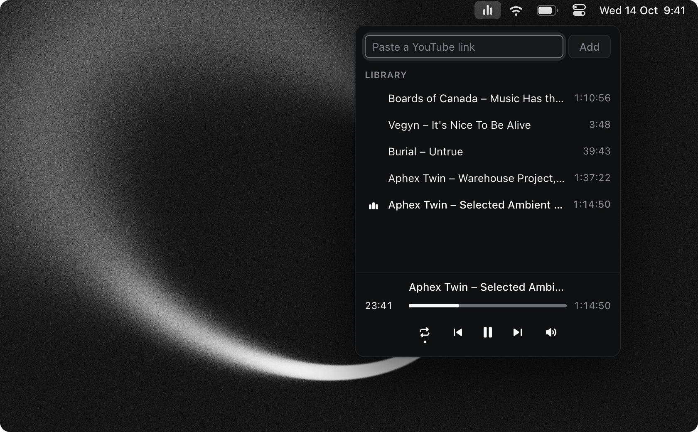

# Menubar Player

Listen to YouTube from the macOS menu bar. Paste a link, close the popover and keep working.
It remembers where you stopped in every track.

https://github.com/user-attachments/assets/71ed81d2-0e74-4f9e-beea-65d074b55f68



## Features

- **Picks up where you left off.** Every track keeps its position, even after you quit. Built for long mixes,
  live sets and podcasts.
- **Stays out of the way.** No Dock icon and no window. Close the popover and the music keeps playing, moving on
  to the next track or repeating the one you're on.
- **Paste to add.** ⌘V anywhere in the popover adds the YouTube link on your clipboard.
- **Media keys and keyboard.** Play, pause and skip from your keyboard; the whole popover works without a mouse.
- **Recovers on its own.** YouTube's stream links expire after a few hours; the app fetches a new one and carries
  on from the same second.

## Install

For Apple Silicon Macs with macOS 14 or later.

### Homebrew

```sh
brew install --cask cagndz/tap/menubar-player
```

This also installs [yt-dlp](https://github.com/yt-dlp/yt-dlp), which the app uses to find the audio of each video.

### Download

Download the DMG from the [latest release](https://github.com/cagndz/menubar-player/releases/latest), open it and
drag the app to Applications. The app needs yt-dlp, so install it too:

```sh
brew install yt-dlp
```

If yt-dlp is missing or out of date, the app tells you and shows the command to fix it.

### First launch

The app is not notarized by Apple, so macOS stops it the first time with "Apple could not verify Menubar Player
is free of malware". To allow it, open **System Settings › Privacy & Security**, scroll down and click **Open
Anyway**. This is only needed once.

Its icon then appears in the menu bar: click it to open the player, right click for the menu.

## Development

You need [Rust](https://rustup.rs), Node.js, [pnpm](https://pnpm.io) and yt-dlp.

```sh
pnpm install
pnpm tauri dev     # run the app
pnpm tauri build   # the app and its DMG, in src-tauri/target/release/bundle
pnpm test          # frontend tests
pnpm lint          # ESLint, no warnings allowed
pnpm format:check  # Prettier
pnpm contrast      # every color pairing of both themes against WCAG AA
cargo test --manifest-path src-tauri/Cargo.toml
```

`http://localhost:1420/preview.html` shows the popover in every state with sample data while the app runs in
development.

Built with Tauri 2, Rust, React, TypeScript, Tailwind CSS 4 and Motion.

## Limitations

- YouTube may ask for a sign-in check on some networks. The app reports it and backs off; it does not use
  browser cookies or any other way around it.
- Single videos only; playlist links are not expanded.
- Videos with several audio tracks (auto-dubbed ones) play the original language.
- Apple Silicon only, and not signed with an Apple developer certificate.

## Disclaimer

A personal project, not affiliated with YouTube or Google. It streams audio for playback and does not download
or save anything. Using it is subject to YouTube's Terms of Service.

## License

[MIT](LICENSE)
